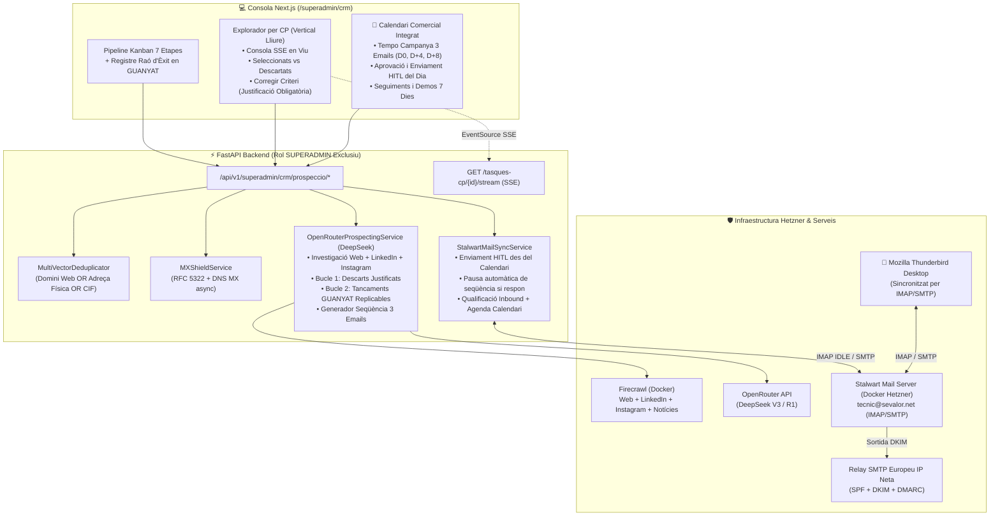

# Pla Tècnic d'Implementació: Motor de Prospecció Atòmica per Codi Postal, Lead Scoring Evolutiu, Seqüències de 3 Emails amb Calendari i Correu Bidireccional (`/superadmin/crm`)

**Macro-Feature**: `007-superadmin-crm-prospeccio-leads`  
**Estat**: Actualitzat segons `spec.md` (SDD)  
**Especificació**: [`sevalor_AgentV2/specs/007-superadmin-crm-prospeccio-leads/spec.md`](file:///media/akaun/Project_1/SEVALOR/sevalor_AgentV2/specs/007-superadmin-crm-prospeccio-leads/spec.md)  
**Data**: 2026-10-26  

---

## 1. Arquitectura del Sistema i Integració amb el CRM Existent

Aquest mòdul s'integra directament sobre el CRM de Superadmin ([`crm_prospeccio.py`](file:///media/akaun/Project_1/SEVALOR/backend/app/api/v1/superadmin/crm_prospeccio.py) i [`pwa/src/app/superadmin/crm/page.tsx`](file:///media/akaun/Project_1/SEVALOR/pwa/src/app/superadmin/crm/page.tsx)), connectant la prospecció amb el Kanban de 7 etapes i el motor de Demos Reals de 7 Dies mitjançant 5 subsistemes:

1. **Motor d'Investigació Atòmica Multi-Canal per Codi Postal (`FirecrawlService`)**:
   - Accepta qualsevol **vertical escrita lliurement per l'operador humà** (sense llista tancada) + un únic `codi_postal` + `operaris_minims`.
   - Investiga tant el **web corporatiu** com perfils públics i mencions recents a **LinkedIn, Instagram, premsa local i adjudicacions** per extreure el Gatekeeper/Decisor i fites recents reals.
   - Aplica **Deduplicació Multi-Validació per 3 Vectors**: si **un o més** entre `domini_normalitzat`, `adreca_normalitzada` o `cif` coincideix amb un registre existent, descarta el candidat com a `DUPLICAT`.
2. **Escut de Verificació DNS (`MXShieldService`)**:
   - Valida sintaxi RFC 5322, absència a `saas_exclusio_rgpd` i existència de registres DNS `MX` actius abans d'admetre qualsevol correu.
3. **Motor de Qualificació i Doble Aprenentatge (`OpenRouterProspectingService` amb DeepSeek)**:
   - **Bucle 1 (Descarts i Seleccions amb Justificació Humana Obligatòria)**: Registra el 100% de les empreses del CP (seleccionades i descartades). Tota correcció humana exigeix un motiu obligatori per entrenar el filtre.
   - **Bucle 2 (Tancaments d'Èxit `GUANYAT` i Replicació *Lookalike*)**: Quan una oportunitat passa a `GUANYAT`, registra la **Raó del Tancament (`rao_tancament_exit`)** i si és **Replicable (`es_replicable = True`)**. El model utilitza aquests patrons per prioritzar empreses amb idèntics requisits i replicar l'argumentari guanyador.
4. **Generador de Campanya de 3 Emails amb Tempo + Calendari Comercial Integrat**:
   - Per a cada lead seleccionat, genera una **seqüència de 3 correus** (`Email 1 [Dia 0]`, `Email 2 [Dia +4]`, `Email 3 [Dia +8]`) vinculada al **Calendari Comercial de `/superadmin/crm`**.
   - L'`Email 1` segueix la fórmula de 5 passos (Gatekeeper $\rightarrow$ Fita recent Web/LinkedIn/Instagram $\rightarrow$ Dolor operatiu $\rightarrow$ Solució Sevalor amb PWA `/operari`, `/gestio` i Bot de Telegram $\rightarrow$ CTA Demo).
   - L'`Email 2` utilitza casos d'èxit replicables del mateix sector i l'`Email 3` tanca oferint la Demo Real de 7 Dies.
5. **Infraestructura de Correu Sobirana (`Stalwart Mail Server + Relay SMTP UE + Thunderbird`)**:
   - Bústia `tecnic@sevalor.net` sincronitzada bidireccionalment per IMAP/SMTP amb **Mozilla Thunderbird** i amb el CRM (`Message-ID`, `In-Reply-To`).
   - Quan entra una resposta d'un lead, **pausa automàticament els correus restants de la seqüència al Calendari**, classifica la intenció amb DeepSeek i actualitza el Kanban i el Calendari (creant esdeveniments de seguiment si és `OBJECCIO_TEMPS`).



---

## 2. Model de Dades i Migració SQL (PostgreSQL 16 & SQLAlchemy 2.0)

Totes les taules pertanyen al domini global de governança de Superadmin i estan protegides per `require_roles(["SUPERADMIN"])`.

### 2.1 Ampliació de `saas_leads` i `saas_oportunitats`

```sql
-- Ampliació de saas_leads amb multi-validació, fites multi-canal i aprenentatge de tancament
ALTER TABLE public.saas_leads
    ADD COLUMN IF NOT EXISTS cif VARCHAR(20),
    ADD COLUMN IF NOT EXISTS web_url VARCHAR(255),
    ADD COLUMN IF NOT EXISTS domini_normalitzat VARCHAR(150),
    ADD COLUMN IF NOT EXISTS adreca_fisica VARCHAR(255),
    ADD COLUMN IF NOT EXISTS adreca_normalitzada VARCHAR(255),
    ADD COLUMN IF NOT EXISTS codi_postal VARCHAR(10),
    ADD COLUMN IF NOT EXISTS carrec_contacte VARCHAR(100),
    ADD COLUMN IF NOT EXISTS fonts_investigades TEXT, -- JSON/llista: web, linkedin, instagram, premsa
    ADD COLUMN IF NOT EXISTS fita_recent TEXT,
    ADD COLUMN IF NOT EXISTS punt_dolor_detectat TEXT,
    ADD COLUMN IF NOT EXISTS angle_atac VARCHAR(50),
    ADD COLUMN IF NOT EXISTS score_qualificacio INTEGER DEFAULT 0 NOT NULL,
    ADD COLUMN IF NOT EXISTS justificacio_ia TEXT,
    ADD COLUMN IF NOT EXISTS mx_validat BOOLEAN DEFAULT FALSE NOT NULL,
    ADD COLUMN IF NOT EXISTS rao_tancament_exit TEXT,
    ADD COLUMN IF NOT EXISTS es_tancament_replicable BOOLEAN DEFAULT FALSE NOT NULL,
    ADD COLUMN IF NOT EXISTS tasca_prospeccio_id UUID;

CREATE INDEX IF NOT EXISTS idx_saas_leads_codi_postal ON public.saas_leads(codi_postal);
CREATE INDEX IF NOT EXISTS idx_saas_leads_domini ON public.saas_leads(domini_normalitzat);
CREATE INDEX IF NOT EXISTS idx_saas_leads_adreca_norm ON public.saas_leads(adreca_normalitzada);
CREATE INDEX IF NOT EXISTS idx_saas_leads_cif ON public.saas_leads(cif);

-- Ampliació de saas_oportunitats per capturar la raó d'èxit i replicabilitat en tancar GUANYAT
ALTER TABLE public.saas_oportunitats
    ADD COLUMN IF NOT EXISTS rao_tancament_exit TEXT,
    ADD COLUMN IF NOT EXISTS requisits_replicables TEXT,
    ADD COLUMN IF NOT EXISTS es_replicable BOOLEAN DEFAULT FALSE NOT NULL;
```

### 2.2 Noves Taules: Lots CP, Candidats, Doble Bucle d'Aprenentatge, Calendari & Seqüència de 3 Emails i Exclusió RGPD

```sql
-- 1. Lot atòmic d'execució per Codi Postal amb Vertical Oberta (escrita per l'humà)
CREATE TABLE IF NOT EXISTS public.saas_prospeccio_tasques (
    id UUID PRIMARY KEY DEFAULT gen_random_uuid(),
    codi_postal VARCHAR(10) NOT NULL,
    vertical VARCHAR(150) NOT NULL, -- Text lliure escrit per l'humà
    operaris_minims INTEGER DEFAULT 5 NOT NULL,
    estat VARCHAR(30) DEFAULT 'PENDENT' NOT NULL, -- PENDENT, EXECUTANT, COMPLETAT, PAUSAT, ERROR
    total_trobats INTEGER DEFAULT 0 NOT NULL,
    total_seleccionats INTEGER DEFAULT 0 NOT NULL,
    total_descartats INTEGER DEFAULT 0 NOT NULL,
    total_duplicats INTEGER DEFAULT 0 NOT NULL,
    resum_execucio TEXT,
    autor_id UUID,
    created_at TIMESTAMPTZ DEFAULT now() NOT NULL,
    completed_at TIMESTAMPTZ
);

-- 2. Registre transparent de TOTS els candidats analitzats al CP (Seleccionats + Descartats + Duplicats)
CREATE TABLE IF NOT EXISTS public.saas_prospeccio_candidats (
    id UUID PRIMARY KEY DEFAULT gen_random_uuid(),
    tasca_id UUID NOT NULL REFERENCES public.saas_prospeccio_tasques(id) ON DELETE CASCADE,
    nom_empresa VARCHAR(150) NOT NULL,
    cif VARCHAR(20),
    web_url VARCHAR(255) NOT NULL,
    domini_normalitzat VARCHAR(150) NOT NULL,
    adreca_fisica VARCHAR(255),
    adreca_normalitzada VARCHAR(255),
    codi_postal VARCHAR(10) NOT NULL,
    vertical VARCHAR(150) NOT NULL,
    fonts_investigades TEXT, -- web, linkedin, instagram, premsa
    email_detectat VARCHAR(150),
    telefon_detectat VARCHAR(30),
    mx_validat BOOLEAN DEFAULT FALSE NOT NULL,
    operaris_estimats INTEGER DEFAULT 0 NOT NULL,
    decisor_nom VARCHAR(100),
    decisor_carrec VARCHAR(100),
    fita_recent TEXT,
    punt_dolor TEXT,
    angle_atac VARCHAR(50),
    score INTEGER DEFAULT 0 NOT NULL,
    estat_decisio VARCHAR(30) NOT NULL, -- SELECCIONAT, DESCARTAT, DUPLICAT, ERROR_EXTRACCIO
    vector_duplicitat VARCHAR(50), -- DOMINI_WEB, ADRECA_FISICA, CIF (si estat_decisio = DUPLICAT)
    motiu_detallat_ia TEXT NOT NULL,
    corregit_huma BOOLEAN DEFAULT FALSE NOT NULL,
    decisio_humana VARCHAR(30), -- SELECCIONAT o DESCARTAT
    motiu_correccio_humana TEXT, -- OBLIGATORI quan corregit_huma = TRUE
    lead_id UUID REFERENCES public.saas_leads(id) ON DELETE SET NULL,
    created_at TIMESTAMPTZ DEFAULT now() NOT NULL,
    updated_at TIMESTAMPTZ DEFAULT now() NOT NULL
);

CREATE INDEX IF NOT EXISTS idx_candidats_tasca ON public.saas_prospeccio_candidats(tasca_id);
CREATE INDEX IF NOT EXISTS idx_candidats_estat ON public.saas_prospeccio_candidats(estat_decisio);

-- 3. Repositori del Doble Bucle d'Aprenentatge (Descarts Justificats + Tancaments d'Èxit Replicables)
CREATE TABLE IF NOT EXISTS public.saas_criteris_feedback (
    id UUID PRIMARY KEY DEFAULT gen_random_uuid(),
    tipus_aprenentatge VARCHAR(40) NOT NULL, -- CORRECCIO_DESCART, CORRECCIO_SELECCIO, TANCAMENT_EXIT_REPLICABLE
    candidat_id UUID REFERENCES public.saas_prospeccio_candidats(id) ON DELETE SET NULL,
    lead_id UUID REFERENCES public.saas_leads(id) ON DELETE SET NULL,
    vertical VARCHAR(150) NOT NULL,
    nom_empresa VARCHAR(150) NOT NULL,
    web_url VARCHAR(255),
    resum_evidencies_o_requisits TEXT NOT NULL,
    decisio_ia_original VARCHAR(30),
    decisio_humana_correcta VARCHAR(30) NOT NULL, -- SELECCIONAT, DESCARTAT, GUANYAT_REPLICABLE
    explicacio_humana_o_rao_exit TEXT NOT NULL, -- Justificació obligatòria del descart o raó de compra
    es_replicable BOOLEAN DEFAULT FALSE NOT NULL,
    actiu BOOLEAN DEFAULT TRUE NOT NULL,
    created_at TIMESTAMPTZ DEFAULT now() NOT NULL
);

CREATE INDEX IF NOT EXISTS idx_feedback_vertical ON public.saas_criteris_feedback(vertical);
CREATE INDEX IF NOT EXISTS idx_feedback_tipus ON public.saas_criteris_feedback(tipus_aprenentatge);

-- 4. Calendari Comercial Integrat i Campanya Seqüencial de 3 Emails + Fils Inbound/Outbound
CREATE TABLE IF NOT EXISTS public.saas_correu_missatges (
    id UUID PRIMARY KEY DEFAULT gen_random_uuid(),
    lead_id UUID NOT NULL REFERENCES public.saas_leads(id) ON DELETE CASCADE,
    tipus_item_calendari VARCHAR(30) DEFAULT 'EMAIL_CAMPANYA' NOT NULL, -- EMAIL_CAMPANYA, RESPOSTA_INBOUND, SEGUIMENT_CALENDARI, REUNIO_DEMO
    pas_sequencia INTEGER, -- 1 (Dia 0), 2 (Dia +4), 3 (Dia +8), NULL si és resposta o reunió
    tempo_dies_offset INTEGER DEFAULT 0 NOT NULL, -- 0, 4, 8
    data_programada TIMESTAMPTZ NOT NULL, -- Data/hora d'aparició al Calendari Comercial
    direccio VARCHAR(20) NOT NULL, -- OUTBOUND, INBOUND, INTERN_CALENDARI
    estat_enviament VARCHAR(30) NOT NULL, -- ESBORRANY_PROGRAMAT, APROVAT_ENVIAT, PAUSAT_PER_RESPOSTA, CANCEL_LAT, REBUT, COMPLETAT
    remitent VARCHAR(150) NOT NULL,
    destinatari VARCHAR(150) NOT NULL,
    assumpte VARCHAR(255) NOT NULL,
    cos_text TEXT NOT NULL,
    message_id VARCHAR(255) UNIQUE NOT NULL,
    in_reply_to VARCHAR(255),
    references_header TEXT,
    intencio_ia VARCHAR(50), -- INTERESSAT_DEMO, INTERESSAT_INFO, OBJECCIO_TEMPS, NO_INTERESSAT, BAIXA_OPTOUT, OUT_OF_OFFICE
    resum_ia TEXT,
    aprovat_per_id UUID,
    sent_at TIMESTAMPTZ,
    created_at TIMESTAMPTZ DEFAULT now() NOT NULL
);

CREATE INDEX IF NOT EXISTS idx_correu_lead ON public.saas_correu_missatges(lead_id);
CREATE INDEX IF NOT EXISTS idx_correu_data_prog ON public.saas_correu_missatges(data_programada);
CREATE INDEX IF NOT EXISTS idx_correu_estat ON public.saas_correu_missatges(estat_enviament);
CREATE INDEX IF NOT EXISTS idx_correu_msgid ON public.saas_correu_missatges(message_id);
CREATE INDEX IF NOT EXISTS idx_correu_inreplyto ON public.saas_correu_missatges(in_reply_to);

-- 5. Llista negra universal d'exclusió RGPD / LSSI i Bounces
CREATE TABLE IF NOT EXISTS public.saas_exclusio_rgpd (
    id UUID PRIMARY KEY DEFAULT gen_random_uuid(),
    email VARCHAR(150),
    domini VARCHAR(150) NOT NULL,
    cif VARCHAR(20),
    motiu VARCHAR(50) NOT NULL, -- OPTOUT_EXPLICIT, REBOT_HARD, MANUAL_SUPERADMIN
    origen_message_id VARCHAR(255),
    created_at TIMESTAMPTZ DEFAULT now() NOT NULL,
    CONSTRAINT uq_exclusio_email_domini UNIQUE (email, domini)
);
```

---

## 3. Disseny dels Sub-Serveis Backend (`backend/app/services/`)

### 3.1 `firecrawl_service.py` — Cerca Multi-Canal (Web + LinkedIn + Instagram + Premsa) i Deduplicació Multi-Validació
1. **Deduplicació Multi-Validació (`verificar_duplicitat_multivector`)**:
   - Normalitza:
     - `domini_normalitzat` (sense `www.`, minúscules).
     - `adreca_normalitzada` (minúscules, sense puntuació supèrflua, normalització d'abreviatures `c/`, `pol. ind.`, etc.).
     - `cif` (majúscules, sense guions ni espais, si s'ha pogut detectar).
   - Executa una consulta `OR` contra `saas_leads`, `empreses` i `saas_exclusio_rgpd`:
     - Si `domini_normalitzat` coincideix $\rightarrow$ `DUPLICAT` (vector: `DOMINI_WEB`).
     - Si `adreca_normalitzada` coincideix $\rightarrow$ `DUPLICAT` (vector: `ADRECA_FISICA`).
     - Si `cif` està present i coincideix $\rightarrow$ `DUPLICAT` (vector: `CIF`).
2. **Investigació Multi-Canal amb Firecrawl**:
   - Extreu el Markdown de la web corporativa (`/v1/scrape` o `/v1/crawl`).
   - Realitza cerca complementària (`/v1/search`) d'activitat pública recent de l'empresa a **LinkedIn, Instagram i notícies/adjudicacions locals** per descobrir qui és el decisor (Gerent / Director Tècnic) i quina fita recent han assolit (nova obra, instal·lació destacada, certificació, nova flota).

### 3.2 `mx_shield_service.py` — Validació DNS MX i Anti-Bounce
1. Valida sintaxi RFC 5322, descarta dominis temporals/genèrics i comprova que no estigui a `saas_exclusio_rgpd`.
2. Resol asíncronament els registres DNS `MX` del domini per certificar `mx_validat = True`.

### 3.3 `openrouter_prospecting_service.py` — DeepSeek Scoring, Doble Aprenentatge i Campanya de 3 Emails
Connecta amb OpenRouter (`deepseek/deepseek-chat` / `deepseek/deepseek-r1`):
1. **Injecció del Doble Bucle d'Aprenentatge al System Prompt**:
   - Recupera de `saas_criteris_feedback`:
     - Els últims **descarts i correccions justificats per l'humà** (`CORRECCIO_DESCART`, `CORRECCIO_SELECCIO`) perquè el model sàpiga exactament quins perfils rebutjar i per què.
     - Els **tancaments d'èxit replicables (`TANCAMENT_EXIT_REPLICABLE`)** amb la seva `rao_tancament_exit` i requisits, instruint el model a atorgar màxima prioritat (*lookalike boost*) a les empreses que compleixin els mateixos requisits i a utilitzar el mateix angle d'èxit.
2. **Generació de l'Esquema Pydantic (`LeadEvaluationSchema`)**:
   - `operaris_estimats`, `decisor_nom`, `decisor_carrec`, `fonts_investigades` (`["web", "linkedin", "instagram", "premsa"]`).
   - `fita_recent`: fita real verificada en qualsevol dels canals.
   - `punt_dolor` i `angle_atac`:
     - `ANGLE_A_VISIBILITAT_TELEGRAM`: Visibilitat en temps real entre oficina (`/gestio`), operari (`/operari`) i client final via **Bot Oficial de Telegram** (sense mencions a WhatsApp).
     - `ANGLE_B_ESTOC_FURGONETES`: Control d'estoc i mermes entre magatzem i furgonetes.
     - `ANGLE_C_CAMP_FACTURA`: Del parte d'obra de 30 segons a l'albarà i factura Veri\*factu sense picar dades.
     - `ANGLE_D_CONEIXEMENT_IA`: Centralització del coneixement tècnic i Copilot IA.
   - `score` (`0..100`), `estat_decisio` (`SELECCIONAT` / `DESCARTAT`) i `motiu_detallat_ia`.
   - `campanya_3_emails`: Llista de 3 objectes (`EmailStepSchema`) amb el seu tempo:
     - **Pas 1 (`offset_dies = 0`)**: Contacte inicial quirúrgic en 5 passos (Gatekeeper $\rightarrow$ Fita recent Web/LinkedIn/Instagram $\rightarrow$ Dolor $\rightarrow$ Solució Sevalor amb PWA i Telegram $\rightarrow$ CTA Demo).
     - **Pas 2 (`offset_dies = 4`)**: Seguiment d'autoritat amb cas replicable d'una empresa d'instal·lacions/manteniment similar.
     - **Pas 3 (`offset_dies = 8`)**: Tancament breu oferint activar la **Demo Real de 7 Dies** aïllada.

### 3.4 `stalwart_mail_service.py` — Calendari Comercial, Enviament HITL i Sincronització IMAP amb Thunderbird
1. **Planificació al Calendari Comercial**:
   - En seleccionar un lead, insereix els 3 correus a `saas_correu_missatges` amb `estat_enviament = 'ESBORRANY_PROGRAMAT'` i `data_programada` a $T_0$, $T_0 + 4\text{ dies}$ i $T_0 + 8\text{ dies}$.
2. **Enviament HITL (`aprovar_i_enviar_correu_calendari`)**:
   - Quan l'humà aprova un correu del Calendari (o de la fitxa), l'envia des de `tecnic@sevalor.net` via Stalwart + Relay SMTP, genera `Message-ID: <uuid@sevalor.net>` i manté el fil `In-Reply-To` / `References` en els passos 2 i 3.
3. **Pausa Automàtica de la Seqüència en Rebre Resposta Inbound**:
   - Quan entra un correu `INBOUND` d'un lead, el servei busca tots els registres `ESBORRANY_PROGRAMAT` pendents d'aquell `lead_id` al Calendari i els passa automàticament a `PAUSAT_PER_RESPOSTA`.
   - Si DeepSeek classifica la resposta com a `OBJECCIO_TEMPS` (ex. *"Parleu-nos d'aquí a 3 setmanes"*), crea automàticament un esdeveniment `SEGUIMENT_CALENDARI` a la `data_programada` sol·licitada.
   - Si classifica `BAIXA_OPTOUT`, passa els pendents a `CANCEL_LAT`, el lead a `DESCARTAT` i insereix a `saas_exclusio_rgpd`.

---

## 4. Contractes d'API REST i SSE (`/api/v1/superadmin/crm/prospeccio`)

| Mètode | Ruta | Descripció |
| :--- | :--- | :--- |
| `POST` | `/tasques-cp` | Inicia un lot atòmic per a un `codi_postal`, una `vertical` (text lliure escrit per l'humà) i `operaris_minims`. |
| `GET` | `/tasques-cp` | Llista els lots de Codi Postal executats amb comptadors de seleccionats, descartats i duplicats. |
| `GET` | `/tasques-cp/{tasca_id}` | Retorna el detall del lot i la llista transparent de tots els candidats (`SELECCIONAT`, `DESCARTAT`, `DUPLICAT`). |
| `GET` | `/tasques-cp/{tasca_id}/stream` | Stream **Server-Sent Events (SSE)** en temps real del progrés del Codi Postal. |
| `POST` | `/candidats/{candidat_id}/corregir-criteri` | Inverteix la decisió de la IA exigint obligatòriament `motiu_correccio_humana` ($\ge 10$ caràcters), crea/descarta el lead amb la seva campanya de 3 emails i ho desa a `saas_criteris_feedback`. |
| `POST` | `/oportunitats/{oportunitat_id}/registrar-exit` | Registra el tancament `GUANYAT` amb `rao_tancament_exit`, `requisits_replicables` i `es_replicable = True`, alimentant el Bucle 2 d'aprenentatge *lookalike*. |
| `GET` | `/criteris-feedback` | Llista tan les regles de descart com els patrons de tancament d'èxit replicables actius. |
| `GET` | `/calendari` | Retorna tots els ítems del **Calendari Comercial** filtrables per rang de dates (`inici`, `fi`) i estat: correus programats (`Pas 1`, `Pas 2`, `Pas 3`), seguiments d'objeccions, reunions i venciments de Demos de 7 dies. |
| `POST` | `/calendari/esdeveniments` | Crea manualment un esdeveniment o recordatori de seguiment al Calendari Comercial vinculat a un lead. |
| `PUT` | `/correus/{correu_id}/esborrany` | Edita l'assumpte, el cos o la `data_programada` d'un dels 3 correus de la seqüència. |
| `POST` | `/correus/{correu_id}/enviar` | **Acció HITL**: Valida i envia des de `tecnic@sevalor.net` un correu de la seqüència programada al Calendari. |
| `GET` | `/leads/{lead_id}/correus` | Retorna la seqüència de 3 correus i tot el fil de missatges (`OUTBOUND` / `INBOUND`) amb les etiquetes d'intenció IA. |
| `POST` | `/correu/sincronitzar-inbound` | Processa els correus entrants via IMAP, pausa automàticament els passos pendents de la seqüència al Calendari, qualifica la intenció amb DeepSeek i actualitza el Kanban i el Calendari. |
| `GET` / `POST` | `/exclusio-rgpd` | Consulta o afegeix registres a la llista negra universal d'exclusió RGPD/LSSI. |

---

## 5. Disseny de la Interfície d'Usuari a `/superadmin/crm`

S'amplia [`pwa/src/app/superadmin/crm/page.tsx`](file:///media/akaun/Project_1/SEVALOR/pwa/src/app/superadmin/crm/page.tsx) amb dues noves pestanyes principals i l'ampliació del modal de fitxa:

1. **Pestanya `"Explorador de Leads per CP"`**:
   - **Formulari amb Vertical Lliure**: Input `Codi Postal` (`25001`), **input de text lliure `Vertical / Sector`** (ex. *"Manteniment industrial"*, amb suggeriments ràpids opcionals però 100% obert a qualsevol text de l'humà), `Mínim Operaris` (`5`) i botó `"Executar Lot CP"`.
   - **Consola SSE en Temps Real**: Mostra l'avanç d'investigació multi-canal (Web, LinkedIn, Instagram, Premsa), el filtre de deduplicació multi-validació (`Domini / Adreça / CIF`) i el botó manual *"Preparar següent CP"*.
   - **Taula Transparent d'Auditoria (Seleccionades vs. Descartades vs. Duplicades)**:
     - En prémer **"Corregir Criteri"** (per descartar o seleccionar), obre un modal que **obliga a escriure la justificació humana** abans de desar.
2. **Pestanya `"Calendari Comercial & Campanyes"` (Indispensable)**:
   - Vista de **Calendari Mensual / Setmanal / Agenda d'Avui**.
   - Mostra els **3 correus de cada campanya segons el seu tempo** (`Email 1 [Dia 0]`, `Email 2 [Dia +4]`, `Email 3 [Dia +8]`), destacant els correus que toquen validar i enviar avui (`PENDENT_APROVACIO_AVUI`), els seguiments agendats per objecció de temps i els venciments de Demos de 7 dies.
   - Permet obrir qualsevol correu directament des del Calendari, revisar-lo i prémer **"Aprovar i Enviar des de tecnic@sevalor.net"** o reprogramar-ne la data.
3. **Modal de Tancament d'Èxit Replicable (`GUANYAT`) al Kanban**:
   - Quan es mou una oportunitat a `GUANYAT` (o des de la fitxa), permet desar la **Raó del Tancament (`rao_tancament_exit`)**, els requisits clau i marcar **"Cas d'Èxit Replicable"** perquè la IA busqui empreses bessones.

---

## 6. Estratègia de Validació i Tests (Normativa Fase 0)

D'acord amb [`Auditoria_i_Normativa_Tests_Backend.md`](file:///media/akaun/Project_1/SEVALOR/sevalor_AgentV2/docs/sdd_sevalor_legacy/Auditoria_i_Normativa_Tests_Backend.md):
- **Zero Mocks de Base de Dades i Zero `db.refresh()`**: Totes les proves d'integració s'executen contra PostgreSQL real amb `create_savepoint`.
- **Cobertura Estricta dels Nous Requisits**:
  - Vertical oberta escrita per l'humà.
  - Deduplicació multi-validació (`Domini Web` $\lor$ `Adreça Física` $\lor$ `CIF`).
  - Rebuig (`422` / `400`) si un humà intenta descartar/corregir sense escriure la justificació obligatòria.
  - Bucle d'aprenentatge de tancaments `GUANYAT` replicables.
  - Generació dels 3 correus amb tempo (`Dia 0`, `Dia +4`, `Dia +8`) al Calendari Comercial i pausa automàtica d'`Email 2` i `Email 3` quan el lead respon a l'`Email 1`.
